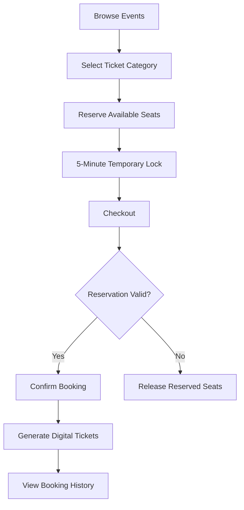

# 🎟️ TicketMaster — Event Ticket Booking & Management System

A full-stack event ticket booking and management platform built with **Python, Flask, and PostgreSQL**. TicketMaster enables users to discover events, reserve seats, purchase tickets, manage bookings, and resell tickets through an approval-based marketplace.

The platform also provides administrators with event management, booking analytics, revenue reports, and resale moderation tools.

## ✨ Key Features

### 👤 User Management
- User registration and login
- Secure password hashing using Werkzeug
- Session-based authentication
- Role-based access control

### 🎫 Event Discovery
- Browse upcoming events
- View detailed event information
- Explore event dates, venues, and ticket availability
- Support for event images

### 🛒 Ticket Booking System
- Three ticket categories: VIP, Normal, and Student
- Category-based ticket pricing
- Real-time seat availability management
- Temporary seat reservation with a 5-minute expiration
- Automated release of expired reservations
- Checkout and booking confirmation
- Personal booking history

### 🎟️ Digital Ticketing
- Unique UUID-based ticket codes
- Automatic seat label generation
- Individual digital ticket pages
- Ticket ownership management

### 🔄 Ticket Resale Marketplace
- Submit tickets for resale
- Automatic resale pricing at 5% below the original ticket price
- Admin approval and rejection workflow
- Public marketplace for approved tickets
- Ticket ownership transfer after resale

### 🛡️ Admin Dashboard
- Create and manage events
- Monitor total events and tickets sold
- Track revenue and recent bookings
- Generate event-wise reports
- Review and moderate resale requests

## 🛠️ Technology Stack

| Component | Technology |
|---|---|
| Backend | Python, Flask |
| Database | PostgreSQL |
| Database Driver | Psycopg 3 |
| Connection Pooling | Psycopg Connection Pool |
| Frontend | HTML5, CSS3, JavaScript |
| Templating | Jinja2 |
| Authentication | Flask Sessions, Werkzeug |
| Configuration | Python-dotenv |
| Production Server | Gunicorn |

## 🏗️ Project Structure

```text
TicketMaster/
│
├── app.py
├── config.py
├── utils.py
├── requirements.txt
├── schema.sql
│
├── routes/
│   ├── __init__.py
│   ├── auth.py
│   ├── events.py
│   ├── booking.py
│   ├── admin.py
│   └── resale.py
│
├── templates/
│   ├── base.html
│   ├── index.html
│   ├── admin/
│   ├── auth/
│   ├── booking/
│   ├── events/
│   └── resale/
│
└── static/
    ├── css/
    └── js/
```

## ⚙️ Installation & Setup

### 1. Clone the Repository

```bash
git clone https://github.com/GofranEmonKhan/TicketMaster.git

cd TicketMaster
```

### 2. Create a Virtual Environment

```bash
python -m venv venv
```

Activate the environment:

**Windows:**
```bash
venv\Scripts\activate
```

**Linux/macOS:**
```bash
source venv/bin/activate
```

### 3. Install Dependencies

```bash
pip install -r requirements.txt
```

### 4. Configure PostgreSQL

Create a PostgreSQL database or configure an existing PostgreSQL instance.

The application supports Supabase PostgreSQL as well.

Create a `.env` file in the project root:

```env
SECRET_KEY=your_secure_secret_key

DB_HOST=your_database_host
DB_PORT=5432
DB_NAME=postgres
DB_USER=postgres
DB_PASSWORD=your_database_password
```

Replace the values with your actual database credentials.

### 5. Initialize the Database

The application automatically executes `schema.sql` during startup and initializes the required database tables.

It also seeds a default administrator account. Change the default credentials in the application before using it in any production environment.

### 6. Run the Application

```bash
python app.py
```

Open your browser and visit:

```text
http://127.0.0.1:5000
```

## 🗄️ Database Design

The application uses PostgreSQL with the following core tables:

| Table | Purpose |
|---|---|
| `users` | User accounts and roles |
| `events` | Event information and ticket inventory |
| `bookings` | Booking records and ticket quantities |
| `ticket_locks` | Temporary seat reservations |
| `tickets` | Individual digital tickets |
| `resale_requests` | Ticket resale and ownership transfer |
| `payments` | Payment transaction records |

## 🔄 Booking Workflow



## 🔐 Security & Access Control

- Passwords are hashed using Werkzeug.
- Database queries use parameterized execution.
- Authentication is managed through Flask sessions.
- Administrative routes are protected through role-based access decorators.
- Ticket operations verify ownership where applicable.

## 🚀 Future Improvements

Potential enhancements include:

- Integration with a real payment gateway.
- Email notifications and booking confirmations.
- QR-code-based ticket verification.
- Automated ticket refund processing.
- Enhanced analytics and reporting.
- Deployment with production-grade security configurations.

## 📌 Project Information

**Project:** TicketMaster  
**Category:** Web Application / Event Management  
**Backend:** Flask (Python)  
**Database:** PostgreSQL  
**Repository:** [GofranEmonKhan/TicketMaster](https://github.com/GofranEmonKhan/TicketMaster)

---

*Developed as an educational software engineering project.*
