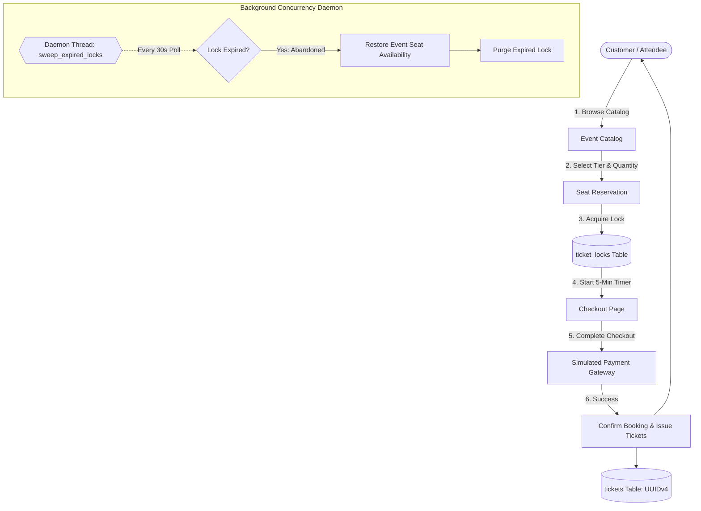
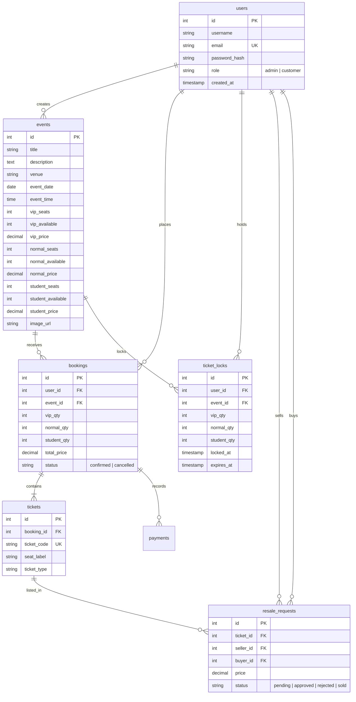

# 🎟️ TicketMaster — Event Ticket Booking & Management Platform

<div align="center">

[](https://www.python.org/)
[](https://flask.palletsprojects.com/)
[](https://www.postgresql.org/)
[](https://www.psycopg.org/psycopg3/)
[](https://gunicorn.org/)
[](LICENSE)

**A full-stack, enterprise-grade event discovery, tiered ticket reservation, and moderated peer-to-peer resale marketplace built with Python, Flask, and PostgreSQL.**

[Key Features](#-key-features) •
[Architecture](#-system-architecture--concurrency) •
[Database Schema](#-database-schema--entity-relationships) •
[Route Overview](#-route--blueprint-architecture) •
[Quickstart](#-installation--setup) •
[Default Credentials](#-default-administrator-account)

</div>

---

## 📌 Project Overview

**TicketMaster** is an end-to-end event ticketing platform engineered to handle real-time seat inventory, concurrent reservation locking, digital ticket issuance, and secondary marketplace resale.

Built with **Flask**, **PostgreSQL (Supabase)**, and **Psycopg 3**, the system tackles critical e-commerce challenges such as inventory overselling, cart abandonment, and secondary scalping through automated background lock sweeping and admin moderation workflows.

---

## ✨ Key Features

### 🎫 1. Tiered Event Discovery & Inventory Management
* **Multi-Tier Ticketing:** Every event supports three independent tiers: **VIP**, **Normal**, and **Student**, each with custom pricing, capacity, and remaining availability.
* **Dynamic Event Catalog:** Real-time visibility of upcoming events, dates, venues, promotional artwork, and remaining seat counts.
* **Auto-Generated Seat Labels:** Systematic seat coding (e.g., `VIP-1`, `NORM-12`, `STUD-4`) ensuring unique physical identification per attendee.

### ⏱️ 2. Concurrency-Safe Seat Reservation (Anti-Overselling)
* **5-Minute Temporary Lock:** When a user proceeds to checkout, the requested seats are deducted from available stock and registered in `ticket_locks`.
* **Background Daemon Lock Sweeper:** An independent Python daemon thread polls the database every 30 seconds. If a user abandons their session or fails to complete checkout within 5 minutes, the locked quantities are atomically restored to the event inventory.

### 🎟️ 3. Cryptographic Digital Ticketing
* **UUID-Based Verification:** Every confirmed seat generates an immutable digital ticket powered by PostgreSQL `pgcrypto` UUIDv4 codes (`ticket_code`).
* **Personal Booking Dossier:** Comprehensive attendee dashboard displaying historical orders, pricing breakdowns, payment statuses, and printable individual ticket vouchers.

### 🔄 4. Controlled Peer-to-Peer Resale Marketplace
* **Resale Submissions:** Attendees who can no longer attend can list their confirmed tickets for resale.
* **Fair Pricing Guarantee:** System automatically prices resold tickets at **5% below original purchase price** to prevent price gouging.
* **Administrative Moderation Workflow:** Resale listings require explicit admin approval or rejection before appearing on the public secondary market.
* **Atomic Ownership Transfer:** Upon purchase, ticket ownership and seat rights are atomically transferred from the seller to the buyer.

### 🛡️ 5. Administrative Command Center & Reporting
* **Event Lifecycle Management:** Create, update, or cancel events, adjust venue details, and recalibrate tier capacities.
* **Sales Analytics & Revenue Metrics:** Real-time aggregations of total tickets sold, gross revenue, category distributions, and recent booking feeds.
* **Resale Moderation Queue:** Review pending ticket resale submissions with one-click approval or rejection actions.

---

## ⚙️ System Architecture & Concurrency



---

## 🗄️ Database Schema & Entity Relationships

The relational architecture is optimized for transactional consistency and integrity:



---

## 🌐 Route & Blueprint Architecture

The backend is modularized into dedicated Flask blueprints:

| Blueprint | Prefix | Core Endpoints | Purpose |
| :--- | :--- | :--- | :--- |
| **`main`** | `/` | `GET /` | Home showcase of upcoming active events |
| **`auth`** | `/` | `GET/POST /login`, `/register`, `/logout` | Session-based authentication & password verification |
| **`events`** | `/events` | `GET /`, `GET /<id>` | Public event discovery and seat tier availability |
| **`booking`**| `/booking` | `POST /lock/<id>`, `GET /checkout`, `POST /confirm`, `GET /history`, `GET /ticket/<code\>` | Temporary lock acquisition, checkout, and digital ticket voucher rendering |
| **`resale`** | `/resale` | `GET /marketplace`, `POST /request/<id>`, `POST /buy/<id>` | P2P ticket listing, secondary marketplace, and ownership transfer |
| **`admin`**  | `/admin`  | `GET /dashboard`, `GET/POST /events/create`, `GET /reports`, `POST /resale-requests/<id>/approve` | Admin metric dashboards, event CRUD, and resale moderation queue |

---

## 🛠️ Technology Stack

| Layer | Technologies Used | Description |
| :--- | :--- | :--- |
| **Backend Framework** | Python 3.10+, Flask 3.1.1 | Application factory pattern with modular blueprint routing |
| **Database** | PostgreSQL 15+ (Supabase) | ACID-compliant relational storage with `pgcrypto` extensions |
| **Database Driver** | Psycopg 3 (`psycopg[binary,pool]`) | Modern connection pooling with PgBouncer compatibility |
| **Production Server** | Gunicorn 21.2+ | Pre-fork worker WSGI HTTP server |
| **Security** | Werkzeug Security | PBKDF2 with SHA-256 password hashing & parameterized SQL |
| **Frontend UI** | HTML5, CSS3, JavaScript, Jinja2 | Responsive layout with dynamic status messaging & modals |

---

## ⚡ Installation & Setup

### 1. Clone Repository
```bash
git clone https://github.com/GofranEmonKhan/TicketMaster.git
cd TicketMaster
```

### 2. Configure Virtual Environment
```bash
# Create environment
python -m venv venv

# Activate (Windows):
venv\Scripts\activate

# Activate (Linux / macOS):
source venv/bin/activate
```

### 3. Install Dependencies
```bash
pip install -r requirements.txt
```

### 4. Configure Environment Variables
Create a `.env` file in the root directory (do not commit this file to version control):

```env
SECRET_KEY=your_generated_secret_key_here

# PostgreSQL / Supabase Database Connection
DB_HOST=your-supabase-db-host.supabase.com
DB_PORT=5432
DB_NAME=postgres
DB_USER=postgres.your_project_id
DB_PASSWORD=your_secure_database_password
```

### 5. Launch the Application
The application automatically executes `schema.sql` on startup to prepare tables and seed the default administrator account.

```bash
python app.py
```

Visit **`http://127.0.0.1:5000`** in your browser.

---

## 🔑 Default Administrator Account

Upon initial startup and schema creation, the application seeds a default administrative user:

* **Email:** `admin@ticketmaster.com`
* **Password:** `admin123`
* **Role:** `admin` *(Access to `/admin/dashboard`)*

> [!CAUTION]
> In any public or production deployment, immediately log in and change this default password to prevent unauthorized administrative access.

---

## 🚀 Production Deployment with Gunicorn

For production environments (Render, Railway, Ubuntu VPS, or AWS EC2):

```bash
gunicorn app:app --workers 2 --threads 4 --bind 0.0.0.0:5000 --timeout 120
```

---

## 📜 License & Authorship

Developed by **[Gofran Emon Khan](https://github.com/GofranEmonKhan)** as part of the Web Programming curriculum, demonstrating full-stack engineering, transactional concurrency control, and database architecture.

Licensed under the [MIT License](LICENSE).
